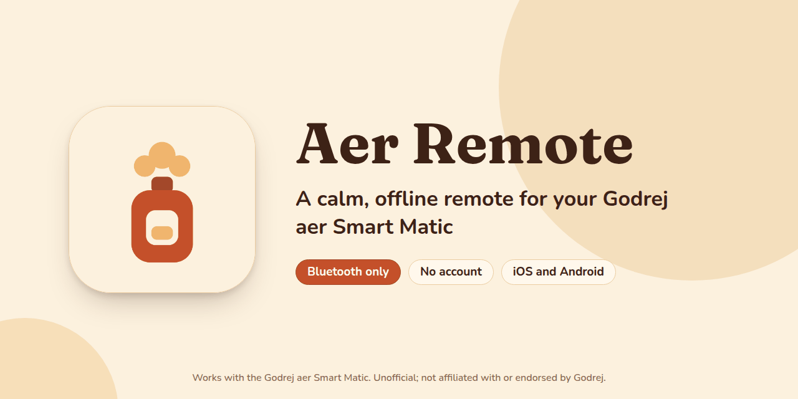
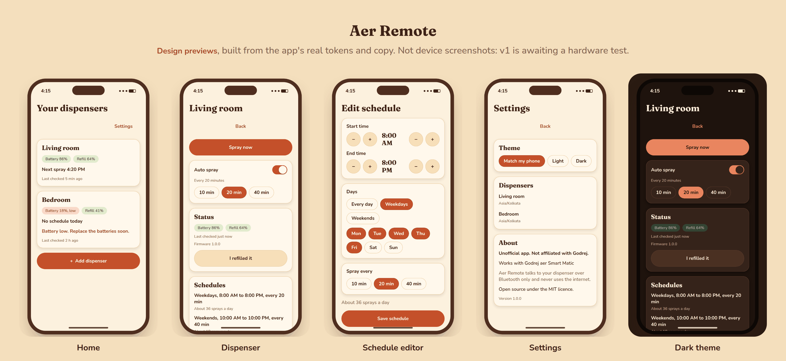
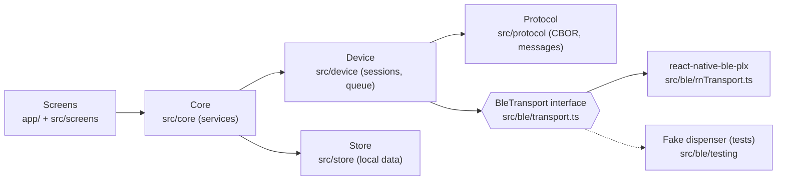
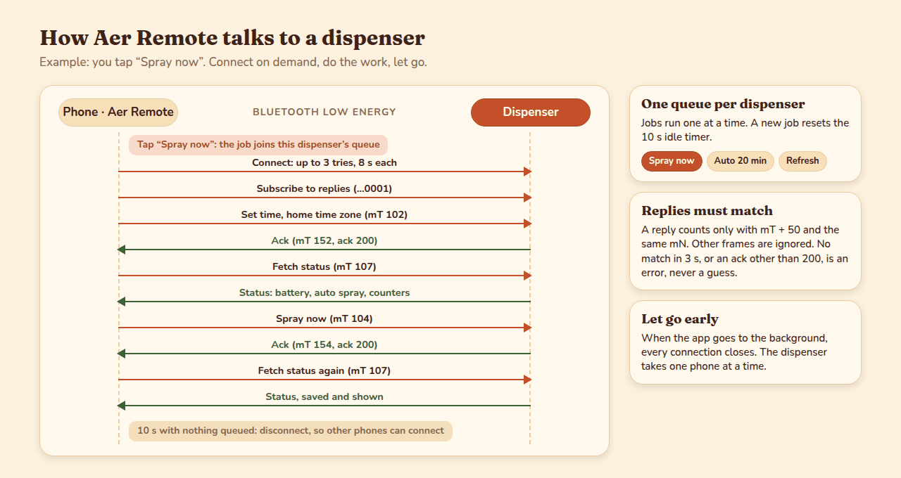

<p align="center">
  
</p>

# Aer Remote

Aer Remote is a phone app that controls a Godrej aer Smart Matic air freshener over Bluetooth. You
can spray on demand, turn auto spray on or off, set up to 10 spray schedules and check the battery
and refill level. It works fully offline, needs no account and runs on iOS and Android.

**Status: v1, awaiting hardware test.** The code is complete and tested against a simulated
dispenser, but it has not yet run on a real one. See [Project status](#project-status-and-roadmap).

Works with the Godrej aer Smart Matic. Unofficial; not affiliated with or endorsed by Godrej.

<p>
  <a href="LICENSE"></a>
  
  
  
  
  
  <a href="https://github.com/DevanshChoubey/aer-remote/actions"></a>
</p>

## Contents

- [Why it exists](#why-it-exists)
- [Features](#features)
- [Screens](#screens)
- [Privacy](#privacy)
- [Compatibility](#compatibility)
- [Getting started](#getting-started)
- [How it works](#how-it-works)
- [Project status and roadmap](#project-status-and-roadmap)
- [FAQ](#faq)
- [Contributing](#contributing)
- [Licence](#licence)
- [Acknowledgements](#acknowledgements)
- [Disclaimer](#disclaimer)

## Why it exists

The official app drops the connection often, has a cluttered interface and is no longer maintained.
It also wants an account for a device that only needs Bluetooth.

Most households set a spray schedule once and leave it. When they do need to change something, the
app should just work. Aer Remote aims to be that app:

- **Reliable.** It connects only when it has work to do, runs one command at a time, retries a
  failed connect, and lets go of the dispenser as soon as it is done.
- **Private.** No account, no server, no analytics and no network permission in release builds.
- **Honest.** It shows what it read from the dispenser, never what it guesses the dispenser holds.

## Features

| Feature            | What it does                                                                                  |
| ------------------ | --------------------------------------------------------------------------------------------- |
| Spray now          | One spray, straight away.                                                                     |
| Auto spray         | Turn it on or off, every 10, 20 or 40 minutes.                                                |
| Schedules          | Up to 10 per dispenser: start, end, days and interval. They run on the dispenser itself.      |
| Read-back          | After each save the app reads the schedules back, so the list shows what the dispenser holds. |
| Status             | Battery and refill level, firmware, and when the status was last checked.                     |
| Refill reset       | Tap "I refilled it" after you put in a new can.                                               |
| Correct clock      | Sets the dispenser's clock on every connection, in the dispenser's home time zone.            |
| Several dispensers | Add, name, find (blink its light), rename and remove. One per room is fine.                   |
| Themes             | Light, dark, or match the phone.                                                              |
| Accessibility      | Labels and roles on every control, 48 dp touch targets, text that scales, AA contrast.        |

## Screens

<p align="center">
  
</p>

> **Design previews, not screenshots.** These images are rendered from HTML that uses the app's real
> colour tokens, fonts (Fraunces and Nunito) and English copy, laid out like the screens in
> `src/screens/`. They are not captured from a device. Real screenshots will replace them after the
> hardware test. Single screens: [Home](docs/images/screen-home.png),
> [Dispenser](docs/images/screen-dispenser.png), [Schedule editor](docs/images/screen-schedule.png),
> [Settings](docs/images/screen-settings.png) and [Dispenser, dark](docs/images/screen-dispenser-dark.png).

## Privacy

Aer Remote talks to your dispenser over Bluetooth only.

- **No network.** The code makes no network calls; ESLint bans `fetch` in every file.
- **No `INTERNET` permission in release builds.** A config plugin removes it
  (`plugins/withReleaseNoInternet.js`). Debug builds keep it so they can reach Metro.
- **No location.** Release builds never ask for location: the location permissions are blocked in
  `app.json`, and Bluetooth scanning on Android uses `neverForLocation`. Debug builds also run on
  Android 11 for hardware testing, and only there ask for precise location, because Android 11 needs
  it to scan.
- **No account, analytics or telemetry.**
- **Local data only.** Dispenser names, home time zones, the last status and the last schedules read
  stay on your phone.

See [SECURITY.md](SECURITY.md) for the scope and how to report a problem.

## Compatibility

| Item      | Supported                                                                     |
| --------- | ----------------------------------------------------------------------------- |
| Dispenser | Godrej aer Smart Matic (Bluetooth). Firmware variants are handled by a probe. |
| Android   | Android 12 or newer (minSdk 31). Debug builds also install on Android 11.     |
| iOS       | A real iPhone with a development or release build. Expo Go is not supported.  |
| Phones    | A real device. Simulators and emulators have no Bluetooth.                    |
| Desktop   | Not yet. Planned for Phase 2.                                                 |

The dispenser accepts one phone at a time. Close the official app, and any other phone connected to
the dispenser, before you use Aer Remote.

## Getting started

You need [Bun](https://bun.sh) and a real phone. Bluetooth does not work on simulators or emulators.

### Android (on Linux)

You need Bun, the JDK (17), the Android SDK with `ANDROID_HOME` set, and an Android 12 or newer phone
with USB debugging on, plugged in. Release builds need Android 12 (minSdk 31). Debug builds also
install on Android 11; there the app asks for location, and Location must be on for scans to find the
dispenser.

```sh
git clone https://github.com/DevanshChoubey/aer-remote.git
cd aer-remote
bun install
bunx expo run:android
```

### iOS (on a Mac)

Bluetooth needs a real iPhone: the iOS simulator has none. It also needs a development build, so Expo
Go will not work. You need Xcode, CocoaPods, and Developer Mode on the iPhone (Settings, Privacy &
Security).

```sh
git clone https://github.com/DevanshChoubey/aer-remote.git
cd aer-remote
bun install
bunx expo run:ios --device
```

Pick your phone when asked. If signing fails, open the `.xcworkspace` under `ios/` in Xcode, choose
your team under Signing & Capabilities and sign in with a free Apple ID.

### Everyday use: release builds

A development build needs Metro running on your computer. For an app that works away from the
computer, install a release build:

```sh
bunx expo run:android --variant release
bunx expo run:ios --device --configuration Release
```

A build signed with a free Apple ID expires after 7 days. Rebuild it then.

### Development

```sh
bun run start   # or: bunx expo start --dev-client
bun run test
bun run typecheck
bun run lint
```

## How it works

The app is split into layers. Screens never touch Bluetooth directly; they call services, and the
protocol and device layers are plain TypeScript, so a desktop app can reuse them later.



Each action opens a short Bluetooth session: connect, set the clock, check the status, do the work,
then disconnect after 10 seconds with nothing to do.

<p align="center">
  
</p>

Read more:

- [docs/ARCHITECTURE.md](docs/ARCHITECTURE.md): the layers, the connection model and how it is
  tested.
- [docs/protocol/aer-ble-protocol.md](docs/protocol/aer-ble-protocol.md): the Bluetooth protocol
  notes.
- [docs/ENGINEERING.md](docs/ENGINEERING.md): the rules every change follows.

## Project status and roadmap

| Stage                  | State                                                                                 |
| ---------------------- | ------------------------------------------------------------------------------------- |
| v1 app                 | Done. All features above, tested against a simulated dispenser.                       |
| Hardware test          | Next. Run the Bluetooth test screen on a real Android phone and iPhone.               |
| Fixes from the test    | After the hardware test. Tune timeouts and retries, or add a native module if needed. |
| Real screenshots       | After the hardware test.                                                              |
| Desktop (Phase 2)      | Planned. The protocol and device layers are already free of React Native.             |
| App Store / Play Store | Later. For now, build and install it yourself.                                        |

The hardware test records the firmware, which channels answered, whether reply notifications work,
and whether 10 of 10 connect-and-status attempts succeed within 5 seconds at about 3 metres. The
results template is [docs/spike/hardware-results.md](docs/spike/hardware-results.md).

## FAQ

### Why does it disconnect from the dispenser after 10 seconds?

The dispenser accepts only one phone at a time. Holding the connection would lock out other phones
in the house, and the official app. So Aer Remote connects when it has work, and lets go after 10
seconds with nothing queued. It also closes every connection when the app goes to the background.

### Why must the official app be closed?

For the same reason: one connection at a time. If the official app, or another phone, is connected,
Aer Remote cannot reach the dispenser and says so.

### Why can't a schedule run overnight, such as 10 PM to 6 AM?

The dispenser stores each schedule as a start time plus a number of sprays, and its window cannot
cross midnight. The app checks that the end time is after the start time. For an overnight window,
add two schedules: one that ends late in the evening (11:55 PM at the latest) and one that starts at
12:00 AM.

### Why is there no pause button for one schedule?

The dispenser keeps no pause flag that the app can read back, and saving rewrites the whole list, so
slot numbers can change. A pause the app cannot show truthfully would be a guess. To pause a
schedule, delete it, and add it again later.

### Does it need the internet or an account?

No. See [Privacy](#privacy).

### Has it been tested on a real dispenser?

Not yet. See [Project status](#project-status-and-roadmap).

## Contributing

Contributions are welcome, especially hardware test results. Read [CONTRIBUTING.md](CONTRIBUTING.md)
first. In short: Bun only, follow [docs/ENGINEERING.md](docs/ENGINEERING.md), run
`bun run test`, `bun run typecheck` and `bun run lint`, and use Conventional Commits. Please follow
the [Code of Conduct](CODE_OF_CONDUCT.md).

## Licence

MIT. See [LICENSE](LICENSE).

## Acknowledgements

The protocol notes build on two open-source projects:

- [AerControl](https://github.com/parthh37/aercontrol) (MIT)
- [godrej_aer](https://github.com/ov1d1u/godrej_aer) (Apache-2.0)

Thank you to their authors. No code from either project, and no vendor code, is included here.

## Disclaimer

Aer Remote is an unofficial, independent project. It is not affiliated with, endorsed by or
supported by Godrej. "Godrej", "aer" and "Smart Matic" are trademarks of their owners and are used
here only to describe compatibility. Use the app at your own risk.
