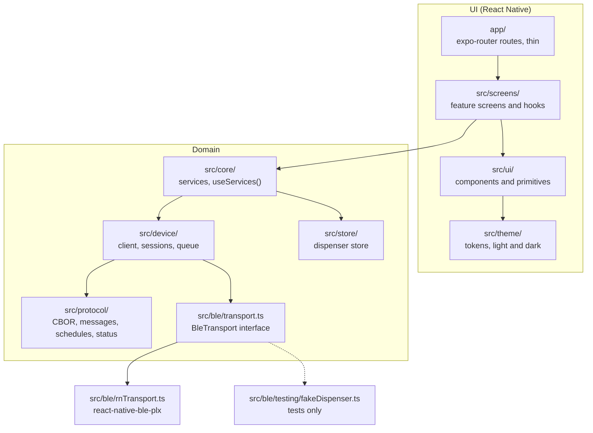
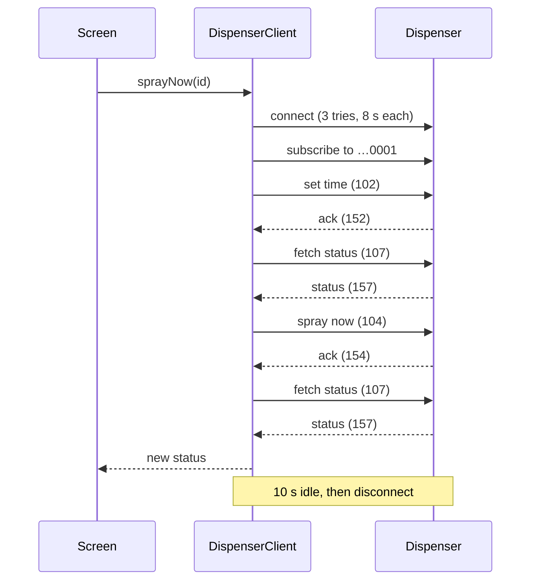

# Architecture

This page explains how Aer Remote is built and why. It covers the layers, the connection model and
its reliability choices, how it is tested, and where things live.

For the rules every change must follow, see [ENGINEERING.md](ENGINEERING.md). For the Bluetooth
protocol, see [protocol/aer-ble-protocol.md](protocol/aer-ble-protocol.md).

> **Status:** v1, awaiting hardware test. Everything below is tested against a simulated dispenser.
> Timeouts and retries are starting values, to be tuned on real hardware.

## Contents

- [Goals that shape the design](#goals-that-shape-the-design)
- [Layers](#layers)
- [Connection model](#connection-model)
- [Reliability choices](#reliability-choices)
- [Schedules](#schedules)
- [Errors](#errors)
- [Testing](#testing)
- [Directory map](#directory-map)

## Goals that shape the design

1. **Connect every time,** and when it can't, say why in plain words.
2. **Set and forget schedules** that run on the dispenser with no phone nearby.
3. **Never hold the dispenser.** It accepts one phone at a time.
4. **Show what the device has,** never what the app thinks it has.
5. **Fully offline.** No account, server, analytics or network calls.
6. **Reusable core.** A desktop app (Phase 2) must be able to reuse the protocol and device code.

## Layers

Imports only point downward. ESLint enforces this per folder (see `eslint.config.js` and
`tests/lint-rules.test.ts`).



| Layer      | Folder               | Why it exists                                                                                               |
| ---------- | -------------------- | ----------------------------------------------------------------------------------------------------------- |
| Routes     | `app/`               | expo-router needs files here. They stay thin and render a screen.                                           |
| Screens    | `src/screens/`       | Feature UI and its hooks. They reach services only through `useServices()` and map errors to friendly copy. |
| Components | `src/ui/`            | `Button`, `Card`, `Chip`, `StatusBadge`, `Toggle`, `Screen`, `EmptyState`. One look, used everywhere.       |
| Primitives | `src/ui/primitives/` | The only place that imports React Native's visual building blocks. Props take token names, not raw values.  |
| Theme      | `src/theme/`         | All colours, fonts, sizes, radii and shadows. Dark mode uses the same token names.                          |
| Copy       | `src/i18n/en/`       | Every user-facing string, so other languages are possible later.                                            |
| Core       | `src/core/`          | Builds the services (client, store, preferences) and hands them to screens.                                 |
| Device     | `src/device/`        | Sessions, the per-device queue, retries, idle close and typed errors. Pure TypeScript.                      |
| Protocol   | `src/protocol/`      | CBOR codec, message builders, schedule bytes, status parsing, reply matching data. Pure TypeScript.         |
| Store      | `src/store/`         | Saved dispensers, with an AsyncStorage backend for the app and a memory backend for tests.                  |
| BLE        | `src/ble/`           | The `BleTransport` interface, the `react-native-ble-plx` adapter, and a fake dispenser for tests.           |

`src/protocol` and `src/device` must not import `react-native`, `expo` or AsyncStorage. They run in
plain Jest and Node, and a desktop app can reuse them with its own `BleTransport`.

## Connection model

The dispenser accepts one central at a time, so the app never keeps a long-lived connection. Every
action opens a short session, does its work and lets go.


What happens when you tap **Spray now**:

1. The job joins the dispenser's queue (`DispenserClient.run`). If a session is already open, it is
   reused.
2. `openSession` asks for Bluetooth permissions, checks the radio is on, and connects. A connect
   attempt may take up to 8 s. It tries 3 times, waiting 0.5 s and then 1.5 s between tries.
3. The session subscribes to the reply characteristic (`…0001`).
4. It sets the dispenser's clock (mT 102) in the dispenser's home time zone.
5. It fetches status (mT 107). If nothing answers, it probes the other aer characteristics and
   remembers the pair that answers (some firmware listens on a different one).
6. The job runs: spray now (mT 104), then fetch status again and save it.
7. With nothing queued for 10 s, the session closes.



## Reliability choices

| Choice                   | How                                                                                                                                                       | Why                                                                              |
| ------------------------ | --------------------------------------------------------------------------------------------------------------------------------------------------------- | -------------------------------------------------------------------------------- |
| On-demand sessions       | Connect only when a job needs the device.                                                                                                                 | Other phones, and the official app, can still reach the dispenser.               |
| Per-device queue         | Each dispenser has its own promise chain. Jobs run one at a time; a session sends one message at a time.                                                  | Replies cannot get mixed up, and two taps cannot race.                           |
| Connect retries          | 3 attempts, 8 s each, with 0.5 s and 1.5 s backoff. A late success after a timeout is cancelled.                                                          | Bluetooth connects fail now and then. A late link must not hold the single slot. |
| Idle close               | 10 s after the last job (`idleMs`). A new job cancels the timer. The close is queued behind running jobs.                                                 | Free the dispenser soon, without reconnecting between quick taps.                |
| Close on background      | When the app goes to the background, `closeAll()` closes every session.                                                                                   | A phone in a pocket must not keep the dispenser.                                 |
| Reply matching           | A reply counts only if its `mT` is the request's plus 50 and its `mN` matches. Other frames are ignored. `ack` other than 200 is `rejected`. 3 s timeout. | A stale or stray reply is never taken as the answer.                             |
| Frame reassembly         | Notifications are buffered until a full CBOR item decodes. Corrupt or oversized buffers are dropped.                                                      | Replies may arrive in pieces. A bad frame must not stall the session.            |
| Channel probe            | If fetch-status gets no reply, try the other aer characteristics (`…0002/3/4`) and save what answers. Never the OTA one.                                  | Firmware differs in which characteristic it listens on.                          |
| Clock on every connect   | Set time with the dispenser's home zone, not the phone's.                                                                                                 | Schedules run on the dispenser clock. A travelling phone must not shift them.    |
| Read-back after save     | After saving schedules, read them back (mT 109) and store that list.                                                                                      | The list on screen is what the dispenser holds, including any rounding.          |
| Never show guessed state | After a failed save, read the list again; if that fails too, forget the list and show "Refresh to see schedules".                                         | Unknown beats stale. Editing an unknown list could erase schedules.              |

## Schedules

Schedules are replace-all, as in the official app:

1. Remove all schedules (mT 108).
2. Wait 3 s (`scheduleGapMs`).
3. Set the full list (mT 103) on the schedule characteristic.
4. Read it back (mT 109) and store the result.

The editor checks a schedule before it can be saved: the end time is after the start time, at least
one day is picked, the window holds at least one spray, and a dispenser has at most 10 schedules.
Each entry is 5 bytes: day mask, start hour, start minute, spray count and interval. The device has
no end time, so the app derives it from the count. If the read-back end differs from what you set,
the editor says "The dispenser rounded the end time to …".

There is no per-schedule pause in v1. The device keeps no readable pause flag, and slot numbers can
shift on replace-all, so a pause could not be shown truthfully.

## Errors

Domain code throws `DeviceError` with one of these codes (`src/device/errors.ts`). Screens map each code to plain copy in
`src/i18n/en/errors.ts` (through `src/screens/errorCopy.ts`), and never show raw error text. A spray
that the device acknowledges while its battery is below 2.4 V is reported as `rejected` with the
battery-too-low copy, because below that voltage the device acks sprays but does not spray.

| Code                        | Shown as                                                                                                   |
| --------------------------- | ---------------------------------------------------------------------------------------------------------- |
| `bluetoothOff`              | Bluetooth is off. Turn it on in your phone settings, then try again.                                       |
| `permissionDenied`          | This app needs permission to find nearby devices. Allow it in your phone settings, then try again.         |
| `unreachable`               | Can't reach the dispenser. Move closer, or close the Godrej app or any other phone that's connected to it. |
| `noReply`                   | The dispenser did not answer. Move closer and try again.                                                   |
| `rejected`                  | The dispenser refused that request. It may be busy or have its own limits. Wait a moment, then try again.  |
| `rejected`, battery too low | Battery too low to spray. Replace the batteries.                                                           |
| `disconnected`              | The connection to the dispenser was lost. Try again.                                                       |
| `timeZone`                  | This dispenser's time zone isn't valid. Pick it again in Settings.                                         |
| Anything else               | Something went wrong. Please try again.                                                                    |

## Testing

Tests use Jest (`bun run test`) and live in `tests/`, mirroring `src/`.

- **Fake dispenser.** `src/ble/testing/fakeDispenser.ts` implements `BleTransport` and behaves like a
  dispenser: it decodes the CBOR requests, keeps schedules, auto spray and counters, and replies on
  `…0001`. Options make it misbehave on purpose: busy, slow, split or dropped replies, a stale reply
  before each real one, a link drop after the nth write, a different command characteristic, an
  unparseable status, a read-only schedule characteristic, and ignored schedule writes.
- **Unit tests** cover the CBOR codec, message bytes, schedule encoding, status parsing, sessions,
  the client and the store.
- **Screen tests** render each screen with React Native Testing Library.
- **An end-to-end flow** (`tests/e2e/scheduleFlow.test.tsx`) adds a dispenser, saves a schedule,
  sprays and checks the home screen, all against the fake.
- **Rule tests** check the layering and that no colour, font or radius literals live outside
  `src/theme/`.
- **Coverage** must stay at 80% of lines or more for `src/protocol`, `src/device` and `src/store`.

What the fake cannot prove is how a real dispenser and phone behave. That is the hardware test:
[spike/hardware-results.md](spike/hardware-results.md).

## Directory map

```text
app/                    expo-router routes (thin)
  dev/spike.tsx         Bluetooth test screen (debug builds only)
assets/images/          app icon and splash
docs/
  ARCHITECTURE.md       this page
  ENGINEERING.md        rules for every change
  images/               README images; src/ holds their HTML sources
  protocol/             Bluetooth protocol notes
  spike/                hardware test results template
plugins/                Expo config plugins (drop INTERNET from release builds)
scripts/                commit-message check, icon and doc-image generators
src/
  ble/                  BleTransport, react-native-ble-plx adapter, fake dispenser
  core/                 services and their React provider
  device/               client, sessions, errors, time zones
  i18n/                 t() and English copy
  protocol/             CBOR, messages, schedules, status, UUIDs
  screens/              home, add, dispenser, schedule, settings
  store/                dispenser and preference stores
  theme/                tokens and theme provider
  ui/                   components and primitives
tests/                  Jest tests, mirroring src/
```
